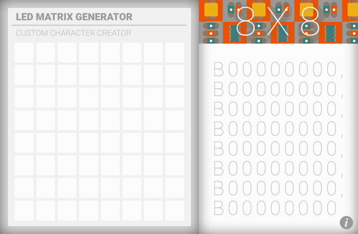
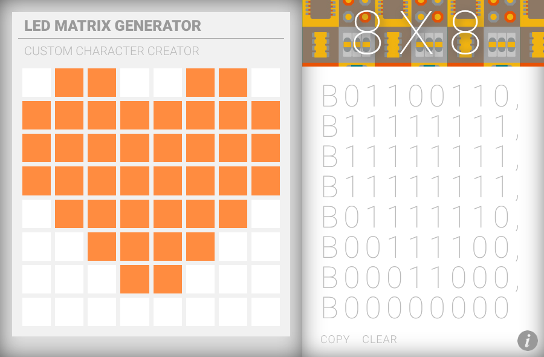

# Arduino LED Matrix Generator

A small web tool to design custom 8×8 characters for an LED matrix and get the matching Arduino array code for the [LedControl](https://github.com/wayoda/LedControl) library. Built for a MAX7219 LED matrix and an Arduino Uno.

**[Try it live](https://aendom.github.io/arduinoledmatrix/)**



## How it works

1. Click any of the 64 cells to turn that LED on. Click it again to turn it off.
2. Click and drag to paint several LEDs at once. Starting on a lit LED erases instead.
3. The panel on the right updates with one binary value per row (`B01100110`, …).
4. **Copy** puts a ready-to-paste Arduino array on your clipboard. **Clear** turns every LED off.
5. Click the **i** button for a short description of the project.

It also works on touch screens, and with the keyboard (**Tab** to move between LEDs, **Enter** or **Space** to toggle).



## Using the output in Arduino

Click **Copy**, paste the array into your sketch and send each row to the matrix with `setRow`:

```cpp
#include <LedControl.h>

// DIN, CLK, CS pins and number of MAX7219 devices
LedControl lc = LedControl(12, 11, 10, 1);

byte character[8] = {
  B01100110,
  B11111111,
  B11111111,
  B11111111,
  B01111110,
  B00111100,
  B00011000,
  B00000000
};

void setup() {
  lc.shutdown(0, false);   // wake up the MAX7219
  lc.setIntensity(0, 8);   // brightness 0–15
  lc.clearDisplay(0);
  for (int row = 0; row < 8; row++) {
    lc.setRow(0, row, character[row]);
  }
}

void loop() {}
```

Adjust the pin numbers to match your wiring.

## Running locally

No build step or install needed. Download the repository and open `index.html` in a browser.

## Built with

- Plain HTML, CSS and JavaScript, with no libraries or build tools
- Roboto (Google Fonts)

On screens narrower than 960 px the two panels stack vertically.

## License

[MIT](LICENSE)
